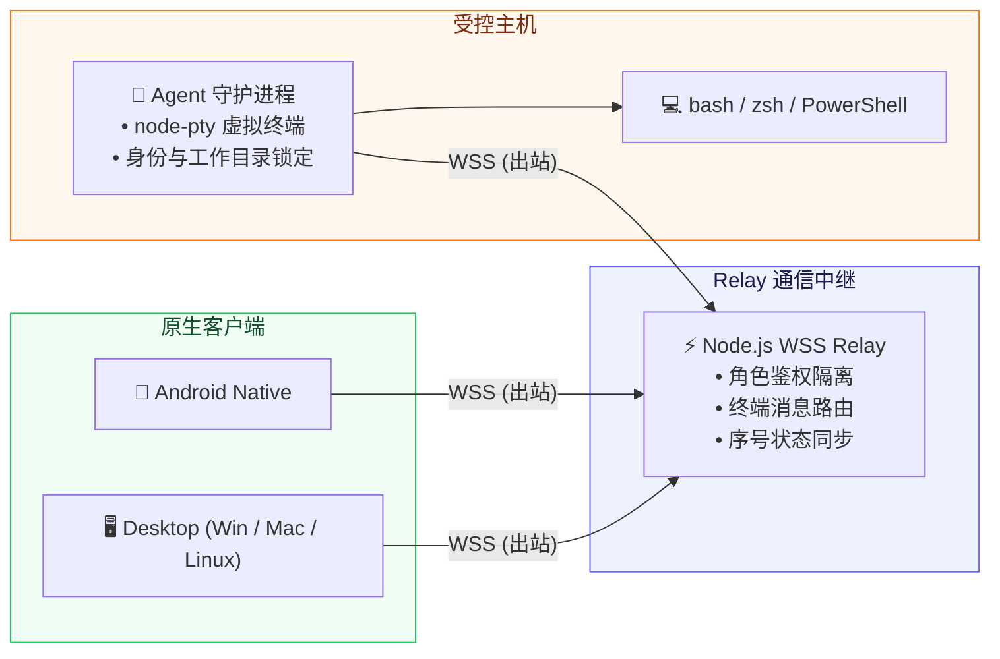

# 💻 Remote Terminal

[](https://developer.android.com/)
[-47848F?logo=electron&logoColor=white)](https://www.electronjs.org/)
[](https://nodejs.org/)
[](https://websockets.spec.whatwg.org/)
[](https://creativecommons.org/licenses/by-nc-nd/4.0/)

> **Remote Terminal** 是一套专为多平台设计的高安全、零入站端口依赖的通用远程终端系统。覆盖 Android、Windows、macOS 与 Linux，客户端与受控端 Agent 均采用向外主动长连接（反向 WSS），受控设备无需开放 SSH、RDP 或公网防火墙入站端口。

---


---

## ✨ 核心特性

- **🔌 反向隧道·零入站端口开放**：受控主机与管理客户端双向主动发起 WSS 连接至轻量 Relay 中继，穿透 NAT 与复杂内网，彻底免去公网端口映射与传统 SSH 暴露风险。
- **🔐 硬件级凭据安全与零按键记录**：
  - **角色双 Token 隔离**：强制拆分只读客户端鉴权凭据（`browserToken`）与受控端凭据（`agentToken`）。
  - **系统级密钥保险箱**：Android 采用 Keystore AES-GCM 加密存储；桌面端依托 Electron `safeStorage` 与受限凭据文件（`0600`）。
  - **零交互痕迹审计**：不留存明文按键交互流，不记录密码或交互式机密。
- **⚡ 工业级终端流控与会话状态保真**：
  - 完整会话快照、断线重连平滑补齐、序号断档安全重同步。
  - 渲染背压控制（Backpressure），防止突发高频大日志压垮客户端渲染引擎。
- **📱 跨平台深度原生交互**：
  - **Android**：虚拟键盘动态顶起终端视图，精准适配系统状态栏、挖孔屏、刘海屏及预测式手势返回。
  - **桌面端（Windows / macOS / Linux）**：多会话多设备秒级切换、智能分屏、大文本粘贴二次确认与终端主题定制。

---

## 🏗️ 系统架构



> **HTTP 控制面说明**：Relay 仅开放 `GET /health` 健康探针与 WebSocket 通信端点，其他所有未授权 HTTP 访问一律返回 `410 Gone`。

---

## 🚀 快速上手与运行

### 1. 中继服务配置 (Relay)

生成两枚独立高强度随机 Token：

```bash
node -e "for(let i=0;i<2;i++) console.log(require('crypto').randomBytes(32).toString('base64url'))"
```

复制配置文件模板 [config.json.example](config.json.example) 并填写 Relay 端口、TLS 证书及设备映射：

```json
{
  "port": 443,
  "bindHost": "0.0.0.0",
  "useTLS": true,
  "tlsCertPath": "/etc/remote-terminal/tls/fullchain.pem",
  "tlsKeyPath": "/etc/remote-terminal/tls/privkey.pem",
  "devices": {
    "production-a": {
      "name": "生产服务器 A",
      "browserToken": "<客户端 Token>",
      "agentToken": "<受控端 Agent Token>"
    }
  }
}
```

以受限权限安装配置文件并启动服务：

```bash
sudo install -o remote-terminal-server -g remote-terminal-server -m 0600 \
  config.json /etc/remote-terminal/server.json
npm ci --prefix /opt/remote-terminal/server --omit=dev --no-audit --no-fund
sudo systemctl enable --now remote-terminal-server.service
```

### 2. 受控端配置 (Agent)

在目标机器既有登录账户下，复制 [agent/config.json.example](agent/config.json.example)：

```json
{
  "agentToken": "<与 Relay 对应的 agentToken>",
  "serverUrl": "wss://terminal.example.cn",
  "requiredUser": "当前用户名",
  "requiredUid": 1000,
  "requiredHome": "/home/当前用户",
  "requiredWorkingDirectory": "/已经存在的原始工作目录",
  "maxSessions": 12
}
```

启动本地受控 Agent：

```bash
chmod 600 agent/config.json
./start-local.sh
```

### 3. 客户端连接与使用

1. 打开 Android 或桌面端客户端，进入「设备」页面点击「添加设备」。
2. 输入设备名称、Relay 地址（如 `wss://terminal.example.cn`）以及分配的 `browserToken`。
3. 保存后即可实时接入受控终端，创建和管理多路 Shell 会话。

---

## 🛠️ 构建与测试

### 构建客户端

```bash
# 构建 Android 客户端 (需 JDK 17 及 Android SDK Platform 35)
cd clients/android
./gradlew assembleRelease

# 构建桌面客户端 (Electron)
cd clients/desktop
npm ci
npm run dist
```

### 自动化测试

```bash
# 运行完整协议与安全测试套件
npm test

# 运行性能与延迟基准评测
npm run test:latency
```

---

## 📄 知识产权与开源协议

本项目遵循 **[Creative Commons Attribution-NonCommercial-NoDerivatives 4.0 International (CC BY-NC-ND 4.0)](https://creativecommons.org/licenses/by-nc-nd/4.0/)** 严格非商业开源许可：

- ❌ **严禁商用**：任何个人或组织不得将本项目源码、编译产物或衍生版本用于任何商业盈利目的。
- ❌ **禁止演绎与分发修改版**：未经授权不得散布基于本项目修改后的二次分发版本。
- 🔒 **权利保留**：作者保留对本项目代码与架构的所有版权与法律追责权利。
