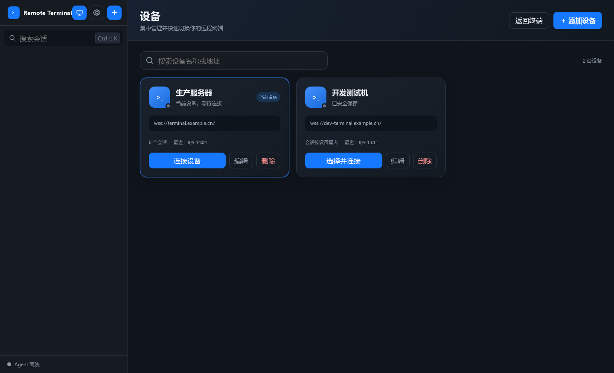

# Remote Terminal

Remote Terminal 是一套面向 Android、Windows、macOS 和 Linux 的远程终端软件。客户端与受控端 Agent 都主动连接阿里云 Relay；受控设备无需开放 SSH、RDP 或额外入站端口。

当前客户端版本为 `0.3.0`。浏览器网页端已经下架，Relay 只保留安全鉴权、终端状态同步和消息转发，不再托管网页，也不依赖 Nginx。



## 使用体验

- 安装后直接进入软件，不要求先填写 IP 或 Token。
- 在“设备”页添加域名和浏览器 Token，可管理、搜索、重命名、删除和切换多台设备。
- 每台设备的会话列表、当前会话、置顶状态和本地别名相互隔离。
- 会话支持新建、查看、搜索、重命名、置顶和删除。
- 本地会话名称不修改后台 ID，适合标记“生产部署”“日志排查”等具体任务。
- 终端支持完整历史快照、滚动回看、回到底部、断线重连和序号断档重同步。
- Android 输入法弹出时会压缩终端可视区域，不遮挡输入框；状态栏、刘海和导航栏使用系统 Insets 适配。
- 桌面端支持快速切换、分屏、快捷键、大段粘贴确认和本地显示设置。

## 系统架构

```text
Android / Desktop ─────── WSS 443 ──────┐
                                        │
                                        ▼
                             Node Relay（原生 TLS）
                                        ▲
                                        │
Agent + node-pty ───────── WSS 443 ─────┘
        │
        └── bash / zsh / PowerShell 所在受控设备
```

Relay 直接监听 `443`，只提供：

- `GET /health`：健康检查
- WSS：客户端/Agent 鉴权、设备路由、会话协议与终端状态同步
- 其他 HTTP 路径：统一返回 `410 Gone`

协议中的客户端角色仍叫 `browser`，仅用于兼容已安装版本，不代表网页端仍然存在。

## 客户端快速开始

1. 安装 Android APK 或桌面安装包并打开软件。
2. 进入“设备”，点击“添加设备”。
3. 填写设备名称、中转域名和该设备的 `browserToken`。
4. 保存并连接，随后在“终端”页查看或新建会话。
5. 进入会话后可滚动查看服务器保留的历史内容；点击“回到底部”返回最新输出。

默认中转地址为：

```text
wss://webclaude.xmu-zss.cn
```

同一个 Relay 可以配置多组设备凭据。客户端也可以保存多个 Relay 地址；设备名称和会话别名只影响本机显示。

## 数据与安全边界

普通本地配置只保存以下内容：

- 设备名称与 WSS 地址
- 当前选择的设备
- 客户端显示设置
- 按设备隔离的会话别名与置顶状态

Token 不写入 `localStorage`：

- Android 使用 Android Keystore 的 AES-GCM 密钥加密，并关闭云备份与设备迁移备份。
- 桌面端使用 Electron `safeStorage`；凭据文件权限为 `0600`。
- Linux 若只能提供 `basic_text` 后端，软件拒绝持久化 Token，只在本次进程内保留。
- 删除设备时会同时清理该设备的 Token、本地会话别名和置顶元数据，但不会误删远端会话。

客户端与 Agent 必须使用两枚不同的随机 Token。持有有效客户端 Token 的用户可以操作 Agent 运行账户权限范围内的完整 Shell，因此本项目不是多租户堡垒机，也不能替代操作系统权限隔离。

## 目录结构

```text
clients/ui/            Android 与桌面端共用的离线 UI
clients/android/       Android WebView 外壳、Keystore 与系统 Insets
clients/desktop/       Electron 外壳、safeStorage 与桌面打包配置
server/                原生 HTTPS/WSS Relay
agent/                 node-pty 终端 Agent
lib/                   鉴权、终端状态和公共协议实现
deploy/systemd/        Relay 与监控 systemd 单元
scripts/               证书、构建、自检和运维脚本
tests/                 单元、协议、TLS、恢复与安全测试
```

## 构建客户端

先安装锁定的共用 UI 依赖：

```bash
npm ci --prefix clients --no-audit --no-fund
```

Android 需要 JDK 17、Android SDK Platform 35 和 Build Tools 35.0.0：

```bash
cd clients/android
./gradlew lintDebug assembleDebug
./gradlew lintRelease assembleRelease
```

输出位置：

```text
clients/android/app/build/outputs/apk/debug/app-debug.apk
clients/android/app/build/outputs/apk/release/app-release-unsigned.apk
```

桌面端：

```bash
cd clients/desktop
npm ci
npm run smoke
npm run dist
npm run dist:win:zip
```

常用输出：

```text
clients/desktop/dist/Remote Terminal-0.3.0.AppImage
clients/desktop/dist/Remote Terminal-0.3.0-win.zip
```

仓库不保存发布签名密钥。Android Release APK、Windows/macOS 安装包应在正式分发前通过受控发布环境完成签名。

## Relay 配置

复制配置模板并生成至少两枚独立随机 Token：

```bash
cp config.json.example config.json
node -e "for(let i=0;i<2;i++) console.log(require('crypto').randomBytes(32).toString('base64url'))"
```

生产配置示例：

```json
{
  "port": 443,
  "bindHost": "0.0.0.0",
  "useTLS": true,
  "tlsCertPath": "/etc/remote-terminal/tls/fullchain.pem",
  "tlsKeyPath": "/etc/remote-terminal/tls/privkey.pem",
  "enableHttpRedirect": false,
  "scrollbackBytes": 524288,
  "scrollbackRows": 10000,
  "devices": {
    "production-a": {
      "name": "生产服务器 A",
      "browserToken": "客户端随机Token",
      "agentToken": "另一枚Agent随机Token"
    }
  }
}
```

Relay 推荐以独立低权限用户运行。systemd 单元只额外授予绑定低端口所需的 `CAP_NET_BIND_SERVICE`：

```bash
cd /opt/remote-terminal/server
npm ci --omit=dev --no-audit --no-fund
sudo install -m 0644 /opt/remote-terminal/deploy/systemd/remote-terminal-server.service /etc/systemd/system/
sudo systemctl daemon-reload
sudo systemctl enable --now remote-terminal-server.service
```

TLS 使用 Certbot standalone。Relay 平时只监听 `443`，`80` 仅在证书签发或续期时临时使用：

```bash
sudo certbot certonly --standalone -d terminal.example.cn
sudo /opt/remote-terminal/scripts/install-relay-certificate.sh terminal.example.cn
sudo certbot renew --cert-name terminal.example.cn --dry-run --no-random-sleep-on-renew
```

证书部署脚本会把证书原子复制到 `/etc/remote-terminal/tls/`，限制私钥权限，然后重启 Relay。无需部署 Nginx、静态网页目录或常驻 80 端口服务。

## Agent 配置与运行

Agent 示例：

```json
{
  "agentToken": "与 Relay 对应设备的 agentToken 一致",
  "serverUrl": "wss://terminal.example.cn",
  "workspaceRoot": "/srv/remote-terminal-workspace",
  "maxSessions": 12,
  "offlineOutputBytes": 524288,
  "auditEnabled": true,
  "auditLogPath": "/var/log/remote-terminal/audit.log"
}
```

启动：

```bash
cd /opt/remote-terminal/agent
npm ci --no-audit --no-fund
CW_CONFIG_PATH=/etc/remote-terminal/agent.json node index.js
```

`workspaceRoot` 只是终端起始目录，不是系统沙箱。受限网络可配置 `proxyUrl`、`HTTPS_PROXY`、`HTTP_PROXY` 和 `NO_PROXY`；私有 CA 应通过 `tlsCaPath` 指定，不应关闭 TLS 校验。

## 更新与运维

从 GitHub 快进更新现有 Relay：

```bash
SERVER_HOST=服务器地址 \
SERVER_SSH_PORT=822 \
REMOTE_DIR=/opt/remote-terminal \
REMOTE_CONFIG_PATH=/etc/remote-terminal/server.json \
bash deploy.sh
```

`deploy.sh` 不上传 Token、配置或私钥，不修改防火墙，只更新干净的远端工作区、安装锁定依赖、重启现有服务并执行健康检查。

可选监控单元 `remote-terminal-monitor.*` 会检查 Relay、TLS、Agent 在线状态、会话数和主机资源。自动恢复默认关闭，只有显式设置 `RT_MONITOR_AUTO_HEAL=1` 才允许重启一次 Relay。

## 测试

```bash
npm ci --prefix clients --no-audit --no-fund
npm ci --prefix server --no-audit --no-fund
npm ci --prefix agent --no-audit --no-fund
npm test
bash scripts/run-server-tests.sh
```

测试覆盖多设备增删改查、会话别名、凭据隔离、客户端离线打包、桌面启动烟测、Android lint/R8、原生 TLS、角色鉴权、真实 PTY、历史快照、输出顺序、渲染背压、断线恢复和资源上限。

## 许可证

MIT，见 [LICENSE](LICENSE)。
